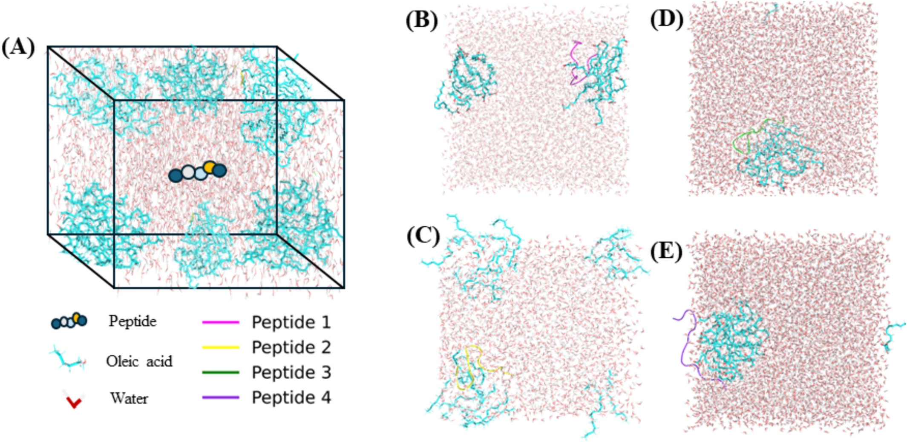

# Protein–Emulsion MD

A compact companion to **Ghosh, I., Ding, S., and Zhang, Y. (2025). Amphiphilic food polypeptides via moderate enzymatic hydrolysis of chickpea proteins: Bioprocessing, properties, and molecular mechanism. Food Chemistry 478, 143602.** [Read the article](https://doi.org/10.1016/j.foodchem.2025.143602).

## What we did and why

We used 100-ns molecular dynamics simulations to investigate how chickpea-derived peptides behave in water–oleic acid model systems and how their sequence amphiphilicity relates to association with the oil phase. Three highly amphiphilic peptides—A2 from alcalase hydrolysis and T1 and T20 from trypsin hydrolysis—were selected following sequence and hydropathy analysis. A fourth peptide with moderate amphiphilicity was included for comparison. Each peptide was simulated separately with 20 oleic acid molecules in water. This comparison probes whether the distribution of hydrophobic and hydrophilic residues supports oil association alongside compatibility with water, providing a molecular perspective on the hydrolysates' emulsifying properties. RMSD and RMSF describe conformational changes and flexibility, while the radial distribution function describes the spatial association of oleic acid with peptide C-alpha atoms. These molecular observations support mechanistic interpretation; they are not direct measurements of macroscopic emulsion stability.

## Original Figure 6

Panel A illustrates the simulation setup. Panels B–E show the initial (0-ns) configurations of Peptides 1–4, respectively. Oleic acid is cyan, water is red, and the peptides are pink, yellow, green and purple. The image is extracted unchanged from page 8 of the supplied article PDF. Figure 6 shows the **four systems: three highly amphiphilic peptides plus one moderately amphiphilic comparator**.

| Article label | Sequence | Hydrolysate | Amphiphilicity | Local source | Figure 6 |
| --- | --- | --- | --- | --- | --- |
| Peptide 1 | ERGDTIKLPAGTIAY | CPPa-5, alcalase | Moderate | seq1 | B |
| Peptide 2 / A2 | KVIVVGEGDVEEK | CPPa-5, alcalase | High | seq2 | C |
| Peptide 3 / T1 | SLLGFGINAQNNQR | CPPt-15, trypsin | High | seq3 | D |
| Peptide 4 / T20 | LLAVIGGNNSPSAK | CPPt-15, trypsin | High | seq4 | E |

## Selected original data

The [data directory](data/) contains the unmodified RMSD, RMSF and RDF exports for all four systems (12 small XVG files). These numerical analyses relate to Figure 7 and Supplementary Figure S3; Figure 6 itself depicts the initial configurations. [Sequences](sequences.fasta), the [system mapping](systems.csv), [column descriptions](data/README.md) and [source hashes](provenance/source_manifest.json) are included.

The article reports AlphaFold2 structure prediction, Schrödinger preparation and CHARMM36 production MD. Local GROMACS 2020.5 records specify a 2-fs time step, 100-ns production, 300 K and 1 bar. This release shares one original figure and selected analysis outputs; the full trajectories and simulation environment are not included, and no simulations were rerun for this release.

## Attribution

Figure 6 is from the cited article, © 2025 Elsevier Ltd., and retains its original rights; it is not covered by the repository's MIT license. The original repository [LICENSE](LICENSE) is retained for repository-owned material. The full publisher PDF is not redistributed here.
